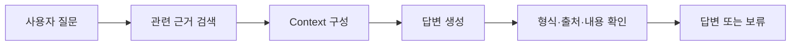

# RAG 고도화 핵심 정리

RAG 고도화는 **질문에 필요한 근거를 더 잘 찾고, 그 근거를 정확한 답변으로 연결하는 작업**입니다.

제공된 자료에서 **6장은 근거 기반 답변**, **7장은 검색 개선**을 다룹니다. 먼저 전체 흐름을 이해한 뒤, 문제가 생기는 단계에 맞춰 개선 방법을 선택하면 됩니다.

## 1. RAG의 기본 흐름

**RAG(Retrieval-Augmented Generation, 검색 증강 생성)**는 질문과 관련된 문서를 검색하고, 찾은 내용을 LLM에 전달해 답변을 만드는 방식입니다. LLM은 문장을 이해하고 생성하는 언어 모델입니다.

미리 문서를 작은 조각으로 나누고 검색할 수 있게 저장합니다. 질문이 들어오면 다음 순서로 처리합니다.



| 용어 | 뜻 |
|---|---|
| 청크(Chunk) | 검색하기 좋게 나눈 문서 조각. 같은 문서의 청크라도 담긴 내용은 다릅니다. |
| 임베딩(Embedding) | 텍스트의 의미적 특징을 숫자 벡터로 표현한 것. Dense 검색에서 사용합니다. |
| 검색기(Retriever) | 질문과 관련된 청크를 찾아 반환하는 구성 요소입니다. |
| Context | 검색 결과 중 실제로 LLM에 전달하는 근거 내용입니다. |
| Top-k | 해당 단계에서 상위 몇 개의 결과를 선택할지 정하는 값입니다. |

**고도화가 필요한 이유:** 관련 문서가 검색돼도, 답이 있는 청크가 빠지거나 중요한 조건이 Context에서 누락될 수 있습니다. 근거를 제대로 전달해도 모델이 내용을 잘못 해석할 수 있습니다.

## 2. 6장: 찾은 근거로 정확하게 답하기

### 6-1. Context 구성

검색 결과를 모두 붙여 넣기보다, **질문에 필요한 내용이 실제 모델 입력에 들어갔는지** 확인합니다.

- **같은 청크의 중복을 제거합니다.** `chunk_id`를 기준으로 처리합니다. 같은 문서라도 질문에 필요한 다른 청크는 남깁니다.
- **근거마다 출처 라벨을 붙입니다.** `[S1]`, `[S2]`처럼 표시하고 실제 청크·문서·원문 위치와 연결해 둡니다. 라벨은 요청마다 새로 매깁니다.
- **입력 길이를 관리합니다.** 필요한 금액·단위·조건이 잘리거나 빠지지 않도록 구성합니다.

검색 후보 수와 Context 예산은 별도 설정입니다. 후보를 많이 찾아도 입력 공간이 부족하면 필요한 근거가 모델에 전달되지 않습니다. 반대로 입력 공간이 넓어도 검색하지 못한 근거를 넣을 수는 없습니다.

> 실습의 Context 예산은 문자 수로 계산합니다. 실제 모델은 토큰이라는 처리 단위로 길이를 세므로, 질문·지시·대화 기록과 답변을 생성할 공간까지 고려해야 합니다. 문자 수와 토큰 수는 같지 않습니다.

### 6-2. 2-Step RAG 연결

**2-Step RAG는 검색과 답변 생성을 연결하는 구조**입니다. 실습 코드는 준비·호출·검사의 세 함수로 나눠 관리합니다.

| 함수 | 역할 |
|---|---|
| `prepare` | 질문으로 검색하고 Context와 출처 목록을 만듭니다. |
| `invoke_model` | 질문·근거·답변 규칙을 모델에 전달합니다. |
| `finish` | 응답 형식과 출처 ID를 검사하고 최종 결과를 정리합니다. |

응답 구조를 정하면 프로그램에서 결과를 일관되게 처리할 수 있습니다. 아래는 **가상 규정에 대한 수동 작성 예시**입니다.

```json
{
  "status": "answered",
  "answer": "국내 출장 숙박비는 1박당 12만원까지 정산할 수 있습니다.",
  "citations": ["S1"]
}
```

`status`는 답변 가능 여부, `answer`는 답변 또는 부족한 정보 안내, `citations`는 사용한 출처 ID입니다. JSON Schema는 필드와 자료형을 정하는 규칙이며, **형식이 맞다고 답변 내용까지 정확한 것은 아닙니다.**

답변 규칙과 참고 문서도 구분합니다. 문서는 근거 데이터로 전달하고, 문서 안의 명령을 실행하지 않도록 합니다.

### 6-3. 출처 연결과 내용 확인

출처는 **어떤 근거가 답변의 어느 내용을 뒷받침하는지** 확인할 수 있게 연결합니다.

1. 인용한 ID가 이번 Context에 실제로 존재하는지 확인합니다.
2. 인용한 발췌문이 해당 원문에 들어 있는지 확인합니다.
3. 답변이 원문의 금액·단위·대상·조건을 유지했는지 대조합니다.

예를 들어 원문이 “국내 출장 숙박 비용 한도는 **1박당 12만원**입니다”인데, 답변을 “**출장 전체 12만원**입니다”로 쓰면 출처가 붙어 있어도 틀립니다.

원문 주소는 저장된 출처 정보에서 가져옵니다. 모델이 주소를 직접 만들어 쓰게 하면 존재하지 않는 링크가 붙을 수 있습니다.

> 실습 코드는 출처 ID와 발췌문의 존재 등을 검사합니다. `review_meaning`은 답변과 발췌문이 달라 의미 검토가 필요하다는 표시이며, 올바른 바꿔쓰기와 잘못된 해석을 자동으로 구별한 결과는 아닙니다.

### 6-4. 근거가 부족할 때 보류

검색 결과가 있다는 이유만으로 답변하지 않습니다. 필요한 사실이 빠졌거나 질문의 대상이 불분명하면, 부족한 정보나 확인할 대상을 안내합니다.

| 상황 | 적절한 대응 |
|---|---|
| 식비·숙박비를 물었는데 합산 금지 규정만 검색됨 | 두 금액을 추가로 검색하거나, 금액 근거가 부족하다고 안내합니다. |
| 해외 항공 좌석 등급을 물었는데 국내 숙박 규정만 있음 | 해외 항공 이용 규정이 필요하다고 안내합니다. |
| “지원 한도는?”처럼 대상이 모호함 | 교육비·식비·숙박비 중 어떤 항목인지 되묻습니다. |

“모르겠습니다”에서 끝내기보다 **무엇을 확인하지 못했고, 어떤 정보가 필요한지** 짧게 설명합니다. 문서에 지원 여부가 없다는 이유로 “지원하지 않는다”고 단정해서도 안 됩니다.

실습은 `insufficient`를 근거 부족·질문 확인에 사용하며 인용 목록을 비웁니다. 서버 연결 실패인 `system_error`, 응답 형식 오류인 `invalid_output`은 따로 구분합니다. Context에 넣을 근거가 전혀 없으면 모델 호출도 생략합니다.

## 3. 7장: 필요한 근거를 더 잘 찾기

### 7-1. BM25와 Dense 검색

| 구분 | BM25 | Dense |
|---|---|---|
| 검색 기준 | 질문과 청크에 겹치는 단어를 중심으로 점수 계산 | 질문과 청크의 임베딩 유사도 계산 |
| 활용하기 좋은 경우 | 정확한 용어·제품명·코드가 중요한 질문 | 같은 내용을 다른 표현으로 물은 질문 |
| 확인할 한계 | 표현·토큰 처리 차이로 근거를 놓칠 수 있음 | 의미가 비슷하지만 답은 없는 청크도 찾을 수 있음 |

예를 들어 “교육비 정산 증빙은?”이라는 질문의 답이 원문에는 “수강 완료 후 수료증과 영수증을 제출합니다”로 적혀 있을 수 있습니다. 표현 차이로 단어 기반 검색이 놓친 근거를 의미 검색이 찾는 데 도움이 될 수 있습니다.

실습의 BM25는 단순한 토큰 분리 때문에 ‘영수증’과 ‘영수증을’을 다르게 처리합니다. 이는 **이 실습의 구현 특성**이며, 한국어 토큰 처리를 개선할 여지가 있습니다.

어떤 검색 방식을 쓰든 올바른 문서 이름만 확인하지 말고, **답이 있는 청크의 본문까지 찾았는지** 확인합니다.

### 7-2. Hybrid Search와 RRF

**Hybrid Search**는 BM25와 Dense처럼 서로 다른 검색 방식을 함께 사용하는 방법입니다. 서로 다른 방식이 찾은 후보를 모아 필요한 근거를 확보할 기회를 넓힙니다.

**RRF(Reciprocal Rank Fusion)**는 검색 결과의 **순위를 기준으로 통합 순위를 만드는 방법**입니다. 여러 목록에서 상위에 나온 청크에 더 높은 값을 줍니다. BM25와 Dense의 원래 점수는 척도가 달라 그대로 더하면 한쪽이 과하게 영향을 줄 수 있습니다.

여기서 세 설정을 구분합니다.

- **검색기별 후보 수:** 각 검색기에서 몇 개를 가져올지 정합니다.
- **재정렬할 후보 수:** 모은 결과 중 몇 개를 다시 평가할지 정합니다.
- **최종 근거 수:** Context에 넣을 후보를 몇 개 선택할지 정합니다. 실제 포함 여부는 입력 예산에도 달려 있습니다.

RRF는 전달받은 후보를 합쳐 순위를 정합니다. 어느 검색기도 찾지 못한 근거를 새로 찾아오지는 못합니다.

### 7-3. Re-ranking

**Re-ranking(재정렬)**은 검색한 후보를 다시 평가해 관련성이 높은 순서로 정리하는 작업입니다.

Dense 검색은 질문과 청크를 각각 벡터로 바꿔 비교합니다. 실습의 **Cross-Encoder**는 질문과 청크를 한 쌍으로 함께 읽고 관련성 점수를 계산합니다. 계산 부담이 있어, 먼저 검색한 후보 일부에 적용합니다.

**RRF는 기존 검색 순위를 합치고, Cross-Encoder는 질문과 본문을 읽어 새 점수를 계산한다**는 차이가 있습니다.

후보에서 빠진 근거는 재정렬로 복구할 수 없습니다. 또한 한 질문의 여러 조건에 답하려면 청크가 여러 개 필요할 수 있으므로, 1위 청크만 고르는 것으로 충분한지 확인해야 합니다.

### 7-4. Query Rewrite와 Multi-Query

검색 표현이 문서 표현과 잘 맞지 않을 때 질문을 다듬거나 여러 표현으로 검색합니다.

| 방법 | 하는 일 |
|---|---|
| Query Rewrite | 질문의 의도를 유지하면서 검색에 맞게 고쳐 씁니다. |
| Multi-Query | 같은 의도의 여러 표현으로 검색해 결과를 모읍니다. |
| 질문 분해 | 복합 질문을 서로 다른 하위 질문으로 나눕니다. 7-4의 기본 실습과는 구분합니다. |

7-4는 “교육비 정산 증빙은 무엇인가요?”라는 원질문에 ‘수강 완료 후 제출’ 등의 표현을 추가해 함께 검색합니다. 질문에 없던 금액이나 추측한 정답을 끼워 넣으면 검색 의도가 달라질 수 있습니다.

검색 전에는 중복 질문을, 검색 후에는 `chunk_id` 기준으로 중복 근거를 제거합니다. 단순히 결과를 합친 순서는 관련도 순위가 아니므로, 필요하면 순위 결합이나 재정렬을 적용합니다. **최종 답변과 재정렬의 기준은 사용자의 원질문**으로 유지합니다.

## 4. 어디부터 개선할까?

| 관찰한 문제 | 먼저 확인하거나 개선할 곳 |
|---|---|
| 원문에 답은 있는데 검색되지 않음 | 문서 수집·청킹·토큰 처리, BM25/Dense, 질의 표현 |
| 필요한 근거가 검색 후보에는 있으나 뒤로 밀림 | RRF, 재정렬, 최종 선택 개수 |
| 검색 후보에는 있으나 모델 입력에서 빠짐 | Context 예산·중복 제거·근거 선택 |
| 근거는 전달됐는데 금액·조건을 틀리게 답함 | 답변 지시·문장별 근거 대조·검증 |
| 답이 없는 질문에도 단정적으로 답함 | 근거 충분성 판단·보류·되묻기 |
| 예전 규정과 현행 규정이 섞임 | 검색 전 문서 버전·상태 필터. 각 검색기에 같은 기준 적용 |

모든 기법을 한꺼번에 추가하기보다, **실제 실패 지점을 확인하고 해당 단계부터 바꾸는 것**이 좋습니다. 질의 수와 재정렬 후보 수를 늘리면 처리 시간과 비용도 늘 수 있습니다.

## 5. 개선 효과 확인하기

같은 문서와 같은 평가 질문을 사용하고, 비교할 설정을 하나씩 바꿉니다. 질문에는 단순 질문, 여러 근거가 필요한 질문, 표현이 다른 질문, 모호한 질문과 자료에 답이 없는 질문을 포함합니다.

확인할 기준은 다음과 같습니다.

- **검색:** 답이 있는 청크와 필요한 근거 전체를 찾았는가?
- **Context:** 찾은 근거가 누락되거나 잘리지 않고 실제 입력에 포함됐는가?
- **답변:** 금액·단위·조건이 맞고, 출처가 각 내용을 뒷받침하는가?
- **보류:** 답할 수 없을 때 적절히 보류하고, 답할 수 있을 때는 답했는가?
- **효율:** 품질 개선에 비해 응답 시간과 비용이 적절한가?

실습의 정답 문서 ID 기준 평가만으로는 답이 있는 청크를 찾았는지나 최종 답변이 맞는지까지 알 수 없습니다. 검색·재정렬 점수도 정답 확률은 아닙니다. 여러 평가 질문의 결과를 함께 확인합니다.

### 내 작업 기록

- 문서와 대상 질문:
- 현재 발견한 문제:
- 바꾼 단계와 설정:
- 같은 질문으로 비교한 개선 전후 결과:
- 남은 문제와 다음 확인 사항:

## 참고 자료와 실습 범위

- [6장 발표 자료](<C:/LLM_전체 복습 파일/RAG_4일차_오전_6장.pptx>): Context, 2-Step RAG, 출처 연결, 답변 보류
- [7장 발표 자료](<C:/LLM_전체 복습 파일/RAG_4일차_오후_7장.pptx>): BM25/Dense, Hybrid/RRF, 재정렬, 질의 재작성
- [ch06 실습 폴더](<C:/LLM_전체 복습 파일/rag_day4/rag_day4/ch06/>), [ch07 실습 폴더](<C:/LLM_전체 복습 파일/rag_day4/rag_day4/ch07/>): `main.py`, `solution.py`, 관련 함수와 정답 코드 참고

예시의 사내 규정과 금액은 교육용 가상 자료입니다. 실습은 단계별로 나뉘어 있으며, 모든 기법을 통합한 하나의 완성 서비스는 아닙니다. 6장의 일부 기본 실행은 수동 작성 응답을 검사하고, 7-4의 기본 검색 표현도 사람이 작성했습니다. 실제 생성 모델을 사용하는 실행과 구분해야 합니다.

이 문서는 자료와 코드를 읽어 개념을 정리했습니다. 실습을 새로 실행한 성능 측정 결과는 포함하지 않았으며, 4~5절은 적용 순서와 평가 관점을 이해하도록 보완한 내용입니다.
