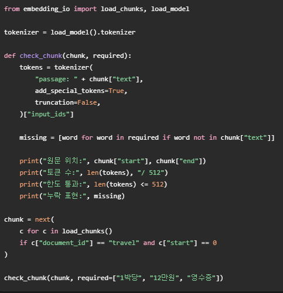

1. Qdrant는 point, colletion, metadata사용 등을 이용해서 데이터를 기존 Numpy로 구성하는 것보다 훨씬 수월하고 빠르게 이행하도록 도와주는 메소드입니다 

2. Qdrant를 사용하기 위해 지켜야할 입력 규칙이 존재하는데 이는 접두사 Passage, Query를 사용하여 어떤 역할을 하는지 알려줍니다 접두사 벡터와 본문을 바탕으로 파악을 하기 때문에 같이 넣어진 토큰량을 고려해야합니다
 

3. Qdrant에는 cloud 기능이 있는데 다른게 아니라 point나 colletion, hit, 유사도 계산해서 하는 부분은 기존과 똑같이 써야하는데 문서를 벡터화시키는 것을 자동으로 실행해주는 기능이 존재합니다
 

4. 해당 동작은 임베딩 하기 전 청킹을 하고 마무리 단계에 간단하게 토큰 길이가 적당한지 검증하는 것입니다

 

5. Qdrant 이외에도 FAISS가 존재하고 이는 벡터 DB, vector store가 아니고 라이브러리로 작동하는 것입니다 vector의 동작을 원할하게 하고 빠르게 하는데는 Qdrant와 비슷하지만 휘발성 문제가 있어서 사용범위가 다릅니다

